# MaquiRent · Dashboard IoT

MaquiRent reúne la temperatura, el nivel relativo de combustible y la ubicación de una máquina en una sola pantalla. La persona encargada de la arrendadora puede revisar las lecturas, identificar una condición de alerta y decidir cuándo hacer una revisión o planear una recarga.

Proyecto del Equipo 7. Unidad configurada: **EXCAVADORA-CAT-01**.

## Abrir el dashboard

Se necesita Node.js 20 o posterior. No hay dependencias que instalar para la interfaz.

```powershell
git clone https://github.com/Blises/maquirent-dashboard.git
cd maquirent-dashboard
npm start
```

Abre **http://127.0.0.1:4177**. Para detenerlo, presiona `Ctrl+C` en la terminal. El código está en un repositorio privado; esta versión se ejecuta en tu computadora y no publica una página en Internet.

## Conectar el prototipo

1. Guarda `firmware/main.py` en la Raspberry Pi Pico con MicroPython. El archivo se ejecuta al iniciar la placa.
2. Verifica las conexiones de los sensores y conecta la Pico por USB a la computadora.
3. Cierra el monitor serial de Thonny para que el gateway pueda abrir ese puerto.
4. Instala los requisitos y ejecuta el puente, cambiando `COM3` por el puerto de la Pico:

```powershell
python -m venv .venv
.venv\Scripts\python.exe -m pip install -r gateway/requirements.txt
.venv\Scripts\python.exe gateway/gateway_mqtt.py --port COM3
```

5. Abre el dashboard. La configuración inicial usa `wss://broker.emqx.io:8084/mqtt` y el tópico `cucei/iot/d06/maquinaria/telemetria`. El gateway publica en el mismo broker mediante TCP 1883.
6. Al llegar un mensaje verás aumentar el contador, actualizarse las tarjetas y aparecer el JSON recibido. El GPS solo coloca un marcador si recibe una posición válida.

La conexión se puede cambiar con el botón de configuración. Para usar otro tópico en el gateway:

```powershell
.venv\Scripts\python.exe gateway/gateway_mqtt.py --port COM3 --topic cucei/iot/d06/maquirent/mi_equipo
```

Escribe exactamente ese tópico en el dashboard. La interfaz admite un broker WSS sin autenticación; otros mecanismos de autenticación requieren ampliar la configuración.

## Sensores y recorrido del dato

| Elemento | Conexión con la Pico | Dato |
| --- | --- | --- |
| DS18B20 | 1-Wire en GP2 | Temperatura en °C |
| Sensor de nivel de agua | ADC0, GP26 | Porcentaje relativo que representa el combustible |
| GPS NEO-6M | UART0 a 9600 baud; GP0 TX a RX del GPS, GP1 RX a TX del GPS | Trama RMC y estado de fijación |
| Raspberry Pi Pico | USB serial hacia la computadora | JSON con las tres lecturas |

Usa tierra común y señales compatibles con 3.3 V. La sonda DS18B20 requiere la resistencia de polarización apropiada para su módulo. El nivel usa `45000` como referencia del ADC: se debe ajustar a las mediciones del sensor antes de interpretar el porcentaje como un nivel calibrado. El sensor de agua se prueba con agua, sin introducirlo en combustible.

```mermaid
flowchart LR
  S[DS18B20 · nivel · GPS] --> P[Raspberry Pi Pico]
  P -->|USB serial · JSON| G[Gateway Python en computadora]
  G -->|Red de la computadora · IP · TCP 1883 · MQTT| B[Broker EMQX]
  B -->|MQTT sobre WSS · TCP 8084| D[Dashboard MaquiRent]
  D --> V[Validación y clasificación de lecturas]
  V --> U[Usuario de la arrendadora]
  U --> A[Seguimiento · revisión · recarga]
```



La red de la computadora puede ser Wi-Fi o Ethernet. La Pico utilizada no necesita conectarse directamente a Wi-Fi. El navegador recibe MQTT sobre WebSocket seguro; el gateway conserva el transporte TCP del prototipo. Los mensajes usan QoS 0 y `retain=false`.

## Condiciones y decisiones

| Estado | Temperatura y nivel | Decisión del usuario |
| --- | --- | --- |
| Normal | Temperatura ≤30 °C y nivel ≥40 % | Continuar el seguimiento. |
| Precaución | Temperatura >30 y ≤35 °C, o nivel ≥15 y <40 %, sin una alerta crítica | Vigilar la temperatura y planear una revisión o recarga. |
| Alerta | Temperatura >35 °C, nivel <15 % o bandera de alerta del dispositivo | Pausar para revisar la temperatura o atender el nivel bajo. |

Estos valores son umbrales de trabajo del prototipo, no especificaciones de operación de una excavadora comercial. La condición térmica y de nivel se muestra por separado del estado del GPS. Una ubicación ausente no se sustituye por una coordenada inventada.

Un dato nulo o fuera de rango aparece como lectura incompleta. Una bandera `false` no anula un valor crítico. Si pasan más de 10 segundos sin lecturas, se indica **Sin datos recientes**; si se pierde el enlace, **Sin conexión**. Las lecturas anteriores permanecen visibles como referencia. Los mensajes retenidos se ignoran para no mostrar un dato antiguo como actual.

## Comprobar los tres estados

Pulsa **Pruebas de estados** y elige Normal, Precaución o Alerta. Cada opción publica entradas controladas cada 2.5 segundos en un tópico temporal separado. La pantalla cambia únicamente cuando recibe el mensaje a través del broker; no se actualiza directamente desde el botón.

Las pruebas conservan GPS sin fijación y se identifican como **Entradas controladas · MQTT**. Pulsa **Volver a sensores** para detenerlas y restaurar el tópico original. Esta función permite comprobar clasificación, transmisión y recepción sin mezclar esos mensajes con los de la Pico.

## Estructura y comprobaciones

```text
index.html                Interfaz
assets/styles.css         Diseño adaptable a computadora y celular
assets/app.js             Suscripción MQTT, mapa, gráficas y controles
assets/telemetry.js        Validación y reglas de condición
assets/vendor/            MQTT.js y Leaflet con sus licencias
firmware/main.py          Lectura de sensores en MicroPython
gateway/gateway_mqtt.py   Puente USB a MQTT
tests/telemetry.test.cjs   Casos de límites, datos inválidos y GPS
server.cjs                Servidor local de la interfaz
```

```powershell
npm test
```

Las pruebas cubren los límites de los estados, banderas contradictorias, lecturas nulas, mensajes ajenos, coordenadas NMEA y configuración del broker. La verificación con sensores requiere conectar el prototipo y revisar que cada cambio físico llegue al dashboard.

## Alcance y limitaciones

- El gateway necesita la computadora, el puerto USB disponible y acceso a Internet. Si se desconecta el USB, hay que corregir la conexión y reiniciar el gateway.
- El broker de EMQX es público: que este repositorio sea privado no hace privados los mensajes MQTT. No deben enviarse ubicaciones o datos confidenciales a este broker.
- QoS 0 no garantiza la entrega de cada mensaje. El dashboard no es un sistema de control automático de la maquinaria.
- El historial y el recorrido se conservan solo en la sesión del navegador. No hay base de datos ni cuentas de usuario.
- El GPS necesita recepción satelital; el mapa y el broker dependen de servicios externos.
- Solo se presenta la unidad configurada. Incorporar más máquinas requiere ampliar la selección de equipos y tópicos.

## Procedencia

La interfaz adapta el dashboard previo de MaquiRent y conserva el formato de datos de los archivos `main.py` y `gateway_mqtt.py` del proyecto. La integración incorpora MQTT.js, Leaflet y Eclipse Paho; sus versiones, enlaces y licencias se indican en [THIRD_PARTY.md](THIRD_PARTY.md).
